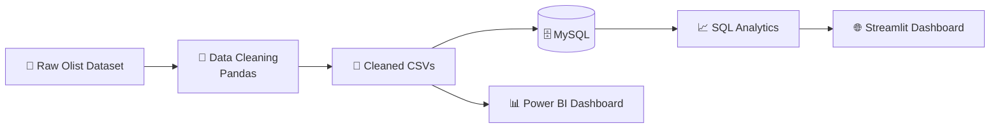
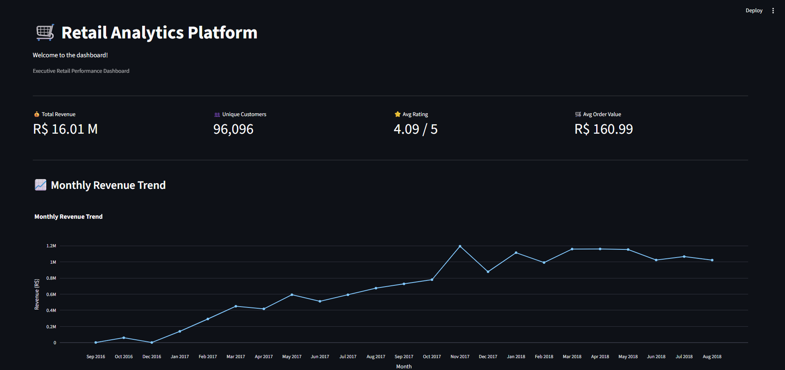
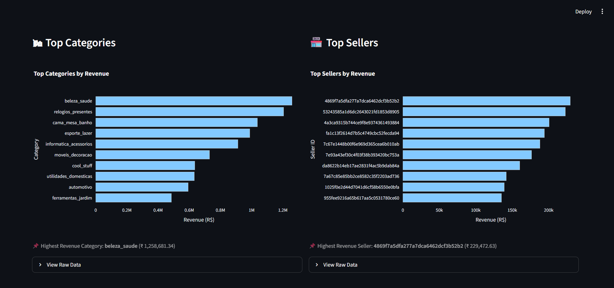
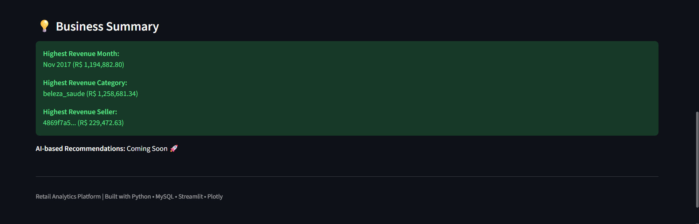

# 📊 Retail Analytics Platform

An end-to-end Retail Analytics Platform built using **Python, MySQL, SQL, Streamlit, and Plotly**. The project follows a real-world analytics workflow, starting from raw retail data, performing data cleaning and preprocessing, storing the cleaned data in a relational database, generating business insights using SQL, and presenting them through an interactive dashboard.

The objective of this project is to demonstrate practical data analytics skills including ETL (Extract, Transform, Load), database design, SQL analysis, data visualization, and dashboard development.

---

## ✨ Features

- 🧹 Cleans and preprocesses raw retail datasets using Pandas
- 🗄️ Stores cleaned data in a normalized MySQL database
- 📈 Generates business KPIs and insights using SQL queries
- 📊 Interactive Streamlit dashboard with key business metrics
- 📉 Visualizes revenue trends, product categories, and seller performance using Plotly
- 🏗️ Modular project structure following real-world development practices
- 📁 Maintains reusable cleaned datasets for further analysis and reporting

---

## 🏗️ Project Workflow


---

## 🛠️ Tech Stack

| Category | Technologies |
|----------|--------------|
| Programming Language | Python |
| Data Processing | Pandas |
| Database | MySQL |
| Query Language | SQL |
| Dashboard | Streamlit |
| Visualization | Plotly |
| Business Intelligence | Power BI *(In Progress)* |
| Development Environment | VS Code |
| Version Control | Git & GitHub |

---

# 📸 Dashboard Preview

The Streamlit dashboard provides an executive overview of retail performance through interactive KPIs, revenue trends, category analysis, seller analysis, and business summaries.

## 🏠 Executive Dashboard

Displays the key business KPIs along with the monthly revenue trend.



---

## 📊 Category & Seller Performance

Compare the highest revenue-generating product categories and sellers.



---

## 💡 Business Summary

A concise summary highlighting the highest revenue month, top-performing product category, top seller, and upcoming AI-powered recommendations.



---

# 🚀 Installation

### 1. Clone the repository

```bash
git clone https://github.com/<your-username>/RetailAnalyticsPlatform.git
cd RetailAnalyticsPlatform
```

### 2. Install dependencies

```bash
pip install -r requirements.txt
```

### 3. Configure MySQL

- Create a database named `retail_analytics`
- Copy .env.example to .env and replace the placeholder values with your local MySQL credentials.

### 4. Load the cleaned datasets

Run:

```bash
python main.py
```

This will:
- Clean the raw datasets
- Save cleaned CSV files
- Load the cleaned data into MySQL

### 5. Launch the dashboard

```bash
streamlit run app.py
```

---

# 🗄️ Database Schema

The project uses a normalized relational database consisting of the following core tables:

- Customers
- Orders
- Order Items
- Order Payments
- Products
- Sellers
- Order Reviews
- Product Category Translation

The relationships were designed using primary and foreign keys to support efficient SQL analysis and dashboard generation.

---

# 📈 SQL Concepts Demonstrated

- INNER JOIN
- GROUP BY
- ORDER BY
- Aggregate Functions
- Date Functions
- KPI Generation
- Revenue Analysis
- Customer Analytics

---

# 🔮 Future Improvements

- Complete the interactive Power BI dashboard
- Add AI-powered business recommendations
- Build customer segmentation using Machine Learning
- Deploy the application to the cloud

---

# 👨‍💻 Author

**Aryan Shinde**

AI & Data Science Engineering Student

Feel free to connect or provide feedback on the project.